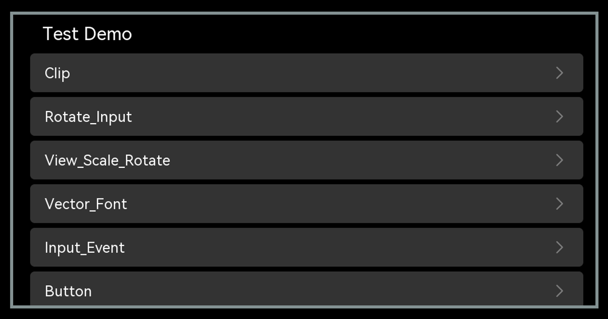

# IP摄像机

开发板默认镜像跑通后，做成 IPC 的差异只在三件事：**装 Sensor、选显示、接网络**。编译与烧录沿用开发板镜像，不需要单独出镜像。

| 差异项 | 开发板形态 | IPC 形态 |
| --- | --- | --- |
| 视频输入 | 无外接 Sensor，仅内置样例码流 | 接 MIPI Sensor：OS08A20（800 万）或 HY_S0603（4K） |
| 显示 | HDMI 可选 | 板载 MIPI 屏或 HDMI，二选一 |
| 存储 | 不涉及 | 录像落盘需先做 eMMC 扩容 |
| 网络 | 不涉及 | 网线接入局域网，DHCP 自动取址，作为监控终端接入平台 |
| 验收关注点 | 桌面可用、media 样例跑通 | 相机出图、拍照录像、图库回放、音频出声 |

## 步骤 1：装配

1. Sensor 模块接 MIPI CSI 接口——默认镜像已含 OS08A20 与 HY_S0603 驱动；换其他型号需按[外设适配实操指南](./porting-smallchip-peripheral.md)增加驱动与 `cameradev_<sensor>.ini` 配置；
2. 显示二选一：插板载 MIPI 屏，或 HDMI 接显示器；
3. 网线接入局域网；
4. 需要本地存录像时，先完成 eMMC 分区扩容与文件系统调整。

## 步骤 2：烧录

镜像与开发板默认镜像完全相同，按 [开发板使用教程](https://gitcode.com/openharmony-sig/device_board_hisilicon_hispark_aifly/blob/master/hispark_aifly/README_zh.md) 烧录即可；镜像已内置相机、图库、桌面与媒体服务。

## 步骤 3：上电验收

1. 上电进入桌面，打开相机应用应实时出图，可拍照、录像；
2. 打开图库回放刚录制的内容；
3. 打开录音机验证音频采集与回放，HDMI 出声；
4. 插拔网线后 DHCP 重新取址，`hdc` 可连接设备。

| 检查项 | 期望结果 |
| --- | --- |
| 开机 | 进入桌面，MIPI 屏与 HDMI 均可显示 |
| 出图 | 相机预览流畅，切换预览分辨率不黑屏、不卡死 |
| 拍照 / 录像 | 文件正常落盘；退出应用或切到图库后相机资源释放，可再次打开 |
| 回放 | 图库可浏览照片、回放录像 |
| 音频 | 录音可回放，HDMI 出声 |
| 网络 | 插网线后获得 IP，`hdc` 可连接设备 |

## Sensor 切换指导

默认 Sensor 为 OS08A20（800 万像素），默认媒体设备配置为 `cameradev_os08a20_928.ini`。HY_S0603（4K）Sensor 支持 1080P 60 帧与 4K 30 帧两种时序：1080P 60 帧时序下 VI 采集为 30 帧，最终显示输出 60 帧；4K 30 帧时序下 VI 采集与显示输出均为 30 帧。

| 时序 | VI 采集 | 显示输出 |
| --- | --- | --- |
| 1080P@60 | 30 fps | 60 fps |
| 4K@30 | 30 fps | 30 fps |

切换为 HY_S0603（以 4K 30 帧时序为例）：

1. 以 `foundation/multimedia/media_lite/services/cameradev_os08a20_928.ini` 为模板，在同目录下新增 `cameradev_hy_s0603_4k30_928.ini`，并在该文件中按 HY_S0603 的 4K 参数（分辨率、帧率、ISP/Sensor 配置等）适配修改；
2. 修改 `foundation/multimedia/media_lite/config.gni`，在 `hispark_aifly / hispark_aiflylite` 分支中将 `media_lite_camera_config_file` 指向新增的 ini 文件（操作方式详见[外设适配实操指南](./porting-smallchip-peripheral.md)第 1.4 节）；
3. 重新编译、烧写。

## 图形示例应用使用指导

图形子系统默认参与系统编译构建，默认镜像已包含图形相关部件，无需单独配置，烧写默认镜像后按以下步骤即可验证示例应用。

图形子系统提供两个示例应用：

- **控件示例应用（sample_ui）**：覆盖图形子系统的控件能力，例如 Button、Label、ScrollView 等；
- **窗口示例应用（sample_window）**：覆盖窗口管理能力，包含窗口的创建、删除以及位置设置。

### 设备端需具备条件

1. 连接 HDMI 显示设备，如显示器、电视；
2. 确认板端能访问测试所需文件，例如通过 tftp 进行网络挂载，或使用 SD 卡；
3. 确认设备驱动 `gfbg.ko`、`ot_tde.ko` 已加载，可在板端用 `lsmod` 查看；
4. 如需支持鼠标，执行 `echo host > /proc/10320000.usb30drd/mode`；
5. 执行 `wms_server &`，在板端用 `top` 确认该进程已启动（显示器点亮为蓝屏）；移动鼠标，若无鼠标可执行 `cat /dev/input/event0`。

### 示例应用验证

#### sample_window（窗口示例）

1. 配置网络：

   ```bash
   ifconfig eth0 <板端IP>
   ```

2. 挂载 sample_window 可执行文件所在目录：

   ```bash
   mount -t nfs -o addr=<服务器IP>,nolock,tcp <服务器IP>:<sample_window所在路径> /mnt
   ```

3. 执行示例：

   ```bash
   ./sample_window
   ```

#### sample_ui（控件示例）

1. 配置网络：

   ```bash
   ifconfig eth0 <板端IP>
   ```

2. 挂载资源目录，并将示例依赖的资源文件（图片、字体等）放到板端对应路径，资源文件清单见[OpenHarmony Small 版本使用指南](https://gitcode.com/HiSpark/Hi3403V100/blob/master/docs/zh-CN/get-started/OpenHarmony%20Small%E7%89%88%E6%9C%AC%E4%BD%BF%E7%94%A8%E6%8C%87%E5%8D%97/OpenHarmony%20Small%E7%89%88%E6%9C%AC%E4%BD%BF%E7%94%A8%E6%8C%87%E5%8D%97.md)：

   ```bash
   mount -t nfs -o addr=<服务器IP>,nolock,tcp <服务器IP>:<资源所在服务器路径> /user/data
   ```

3. 挂载 sample_ui 可执行文件所在目录：

   ```bash
   mount -t nfs -o addr=<服务器IP>,nolock,tcp <服务器IP>:<sample_ui所在路径> /mnt
   ```

4. 执行示例，屏幕显示如[图 1](#图-1-启动画面结果)画面即为验证通过：

   ```bash
   ./sample_ui
   ```

   <div align="center">

   **图 1**  启动画面结果

   

   </div>
