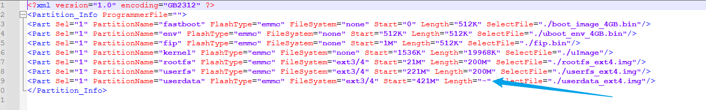
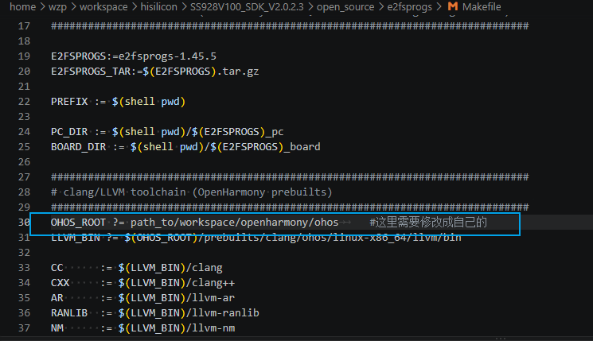
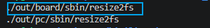
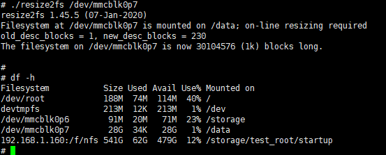
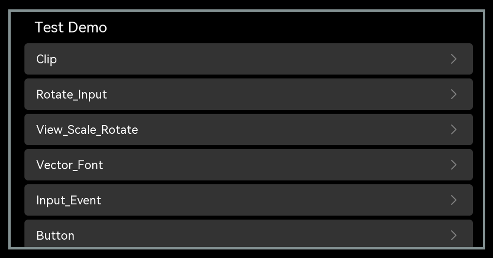

# IP摄像机（典型产品）

本文说明如何基于 HiSpark AiFly 开发板（Hi3403V100，OpenHarmony 小型系统）开发出一款具体产品——**智能网络摄像机**：第 1 章给出产品硬件规格，第 2 章说明产品形态与开发板形态的差异，第 3 章按五个阶段（装配 → 烧录 → 上电验收 → 产品化定制 → 量产准备）描述从开发板到产品的开发路径。

开发板默认镜像跑通后，做成 IPC 的基础差异只在三件事：**装 Sensor、选显示、接网络**。基础形态下编译与烧录沿用开发板默认镜像，不需要单独出镜像；仅当更换 Sensor、屏幕等外设或扩展产品功能时，才需要按下文第 3 章重新编译。

## 1 产品定义与规格

### 1.2 硬件规格

| 规格项 | 规格值 | 说明 |
| --- | --- | --- |
| 主控 | Hi3403V100：四核 ARM Cortex-A55@1.4GHz（Neon、FPU），内置 32bit MCU@500MHz，支持 TrustZone | 内置 MCU 可承接低延时控制类任务 |
| AI 算力 | NPU 10.4TOPS@INT8（双内核异构引擎），双核 Vision Q6 DSP | 含双目深度加速、矩阵计算加速单元 |
| 内存 | LPDDR4/LPDDR4x 4GB | 芯片最高支持 8GB、速率 3733Mbps；当前固件配套 4GB DDR 配置（`boot_image_4GB.bin`） |
| 图像传感器 | OS08A20 | 默认镜像已内置该款 Sensor 驱动与 ISP 算法库 |
| 镜头 | CS/C 口可换镜头 | ISP 支持 3A（AE/AWB/AF），可选电动变焦镜头实现自动对焦 |
| 显示 | 板载 MIPI 屏或 HDMI 2.0 外接显示器，二选一 | 芯片最大输出能力 4096×2160@60fps + 1920×1080@60fps |
| 触摸 | GT911 电容触摸（配 MIPI 屏形态） | 触摸参数经 `input_config.hcs` 配置 |
| 音频 | 麦克风/线性输入（AI）+ 扬声器输出（AO），或 HDMI 音频输出 | 整机整备时按参考设计接入 MIC/SPK |
| 本地存储 | eMMC 5.1（录像/照片落盘，需先完成分区扩容），可扩展 SD 卡（SDIO3.0） | 录音默认保存至 `/userdata/audio/` |
| 网络 | 2 个千兆以太网口（RJ45），DHCP 自动取址并自动配置默认路由与 DNS | |
| 扩展接口 | 2 个 USB3.0/USB2.0、2-Lane PCIe2.0、2 个 SDIO3.0、多路 UART/I²C/SPI/GPIO | 可经 PCIe/SDIO 扩展 WiFi 等无线模组 |
| 供电 | DC 适配器供电（沿用开发板套件配置） | 整机功耗与供电规格在结构设计阶段核定 |

## 2 开发板形态与产品形态差异

| 差异项 | 开发板形态 | 产品形态 |
| --- | --- | --- |
| 视频输入 | 无外接 Sensor，仅内置样例码流 | 接 MIPI Sensor：OS08A20（800 万） |
| 显示 | HDMI 可选 | 板载 MIPI 屏或 HDMI，二选一 |
| 存储 | 不涉及 | 录像落盘需先做 eMMC 扩容 |
| 网络 | 不涉及 | 网线接入局域网，DHCP 自动取址，作为监控终端接入平台 |
| 验收关注点 | 桌面可用、media 样例跑通 | 相机出图、拍照录像、图库回放、音频出声 |

## 3 开发路径

从开发板到产品共五个阶段，总体路径如下：

```
阶段1 装配 → 阶段2 烧录 → 阶段3 上电验收 → 阶段4 产品化定制 → 阶段5 量产准备
```

其中阶段 1～3 使用开发板默认镜像即可完成；阶段 4 为产品化定制开发（按产品差异选做，涉及外设更换时需重新编译）；阶段 5 面向量产（安全使能与兼容性认证）。

### 3.1 阶段 1：装配

1. Sensor 模块接 MIPI CSI 接口——默认镜像已含 OS08A20；换其他型号需按[外设适配实操指南](./porting-smallchip-peripheral.md)增加驱动与 `cameradev_<sensor>.ini` 配置（`busId` 对应 MIPI RX 通道号，AiFly 默认 Sensor 接 CSI 通道 2）；
2. 显示二选一：插板载 MIPI 屏，或 HDMI 接显示器；
3. 网线接入局域网；
4. 需要本地存录像时，先完成 eMMC 分区扩容与文件系统调整（见 3.4.2）；
5. 音频整备：麦克风/扬声器按整板参考设计接入（AI/AO），HDMI 形态直接经 HDMI 出声。

### 3.2 阶段 2：烧录

镜像与开发板默认镜像完全相同，按 [开发板使用教程](https://gitcode.com/openharmony/device_board_hisilicon/blob/master/hispark_aifly/README_zh.md) 烧录即可；镜像已内置相机、图库、桌面与媒体服务。

### 3.3 阶段 3：上电验收

1. 上电进入桌面，打开相机应用应实时出图，可拍照、录像；
2. 打开图库回放刚录制的内容；
3. 打开录音机验证音频采集与回放，HDMI 出声；
4. 插拔网线后 DHCP 重新取址，`hdc` 可连接设备。

| 检查项 | 期望结果 |
| --- | --- |
| 开机 | 进入桌面，MIPI 屏与 HDMI 均可显示 |
| 出图 | 相机预览流畅，切换预览分辨率不黑屏、不卡死 |
| 拍照 / 录像 | 文件正常落盘；退出应用或切到图库后相机资源释放，可再次打开 |
| 回放 | 图库可浏览照片、回放录像 |
| 音频 | 录音可回放，HDMI 出声 |
| 网络 | 插网线后获得 IP，`hdc` 可连接设备 |

### 3.4 阶段 4：产品化定制

阶段 4 各小节相互独立，按产品实际差异选做；全部完成后再次执行 3.3 的验收用例做回归。

#### 3.4.1 外设更换（Sensor / 显示 / 触摸）

默认镜像仅内置 OS08A20 驱动与参考面板配置。更换 Sensor、MIPI 屏或触摸模组的完整适配步骤见[外设适配实操指南](./porting-smallchip-peripheral.md)，完成后重新编译烧录。

#### 3.4.2 录像落盘与存储扩容

1. eMMC 扩容：录像落盘前需完成 eMMC 分区扩容与文件系统调整，主要环节为调整分区表、修改 rootfs 打包配置、重编镜像并在板端扩容，参考下图流程：

    <div align="center">

    **图 1**  eMMC 分区表调整

    

    </div>

    <div align="center">

    **图 2**  rootfs 打包配置修改（Makefile）

    

    </div>

    <div align="center">

    **图 3**  编译产物变化

    

    </div>

    <div align="center">

    **图 4**  板端扩容生效

    

    </div>

2. 落盘路径：相机应用拍照/录像、录音机（`/userdata/audio/`）均落至用户数据分区，扩容容量按录像码率与期望留存天数估算（例如主码流 4K@30 H.265 按 4~8Mbps 规划，每日约 40~80GB，结合循环覆盖策略确定容量）；
3. 可选 SD 卡（SDIO3.0）作为扩展存储与导出介质。

#### 3.4.3 网络接入与平台对接

1. 局域网接入：网线接入后 DHCP 自动获取 IP、默认路由与 DNS，无需手工配置；调试可经 `hdc tconn <设备IP>:8710` 远程连接；
2. 平台对接：默认镜像完成"采集 → 编码 → 封装 → 落盘 → 回放"的本地媒体闭环，作为监控终端上报 NVR/云平台（RTSP/ONVIF/GB28181 等协议栈）属于产品差异化开发内容，取流路径两条：
   - 业务应用经 camera_lite 的 H264 编码回调流获取编码数据后推流；
   - 直接对接 MPP VENC（经媒体 HAL 封装的 `libmpp_codec.so` 能力）自行取流封装。

#### 3.4.4 AI 智能分析

按智能功能需求选择推理路径，开发细节见[高阶功能说明](./advanced-features.md)：

| 需求 | 推荐路径 | 文档 |
| --- | --- | --- |
| 人形/车辆等实时目标检测 | NPU + ModelZoo（如 YOLOv9s） | [NPU 推理与 ModelZoo 案例](./porting-smallchip-ai-NPU-ModelZoo.md) |
| 统一接口调用 NPU（分类等） | SVPDelegate（MindSpore Lite Delegate，C API） | [通过 SVPDelegate 调用 NPU](./porting-smallchip-ai-NPU-MindSporeLite-svp-delegate.md) |
| 轻量模型/快速原型 | CPU + MindSpore Lite | [轻量推理框架 MindSpore Lite](./porting-smallchip-ai-CPU-MindSporeLite.md) |

检测输出（目标框/类别/置信度）在应用层叠加越界、区域入侵等业务规则后联动录像与告警。

#### 3.4.5 产品应用开发

- 系统已内置 launcher、相机、图库、录音机，可直接作为产品交付形态；亦可参考 `applications_sample_camera`（相机/图库应用源码仓）定制产品专属交互；
- 新增产品应用：DevEco Studio 开发 ArkJS 应用，编译为 HAP 后经 `hdc install` 安装（BMS 支持多应用安装与管理）；
- 应用签名与验签由 security_appverify 保障，发布前需完成应用签名流程。

### 3.5 阶段 5：量产准备

#### 3.5.1 安全使能

1. **KEY0 烧写**：量产阶段需一次性烧写 OTP KEY0（硬件密钥派生的根密钥），烧写后不可重复烧写，且软重启不生效、需上下电重启；烧写操作与命令示例见[移植案例 XTS 认证章节](./porting-hispark_aifly-on_small-demo.md)。KEY0 未烧写时硬件会拦截密钥派生操作，HUKS 加解密用例无法通过；
2. **安全启动**：按[安全子系统使用说明](https://gitee.com/HiSpark/pegasus/blob/master/docs/04API%E5%8F%82%E8%80%83/%E5%AE%89%E5%85%A8%E5%AD%90%E7%B3%BB%E7%BB%9F/%E5%AE%89%E5%85%A8%E5%AD%90%E7%B3%BB%E7%BB%9F%E4%BD%BF%E7%94%A8%E8%AF%B4%E6%98%8E.md#ZH-CN_TOPIC_0000002424349950)完成镜像签名与加密制作、安全启动使能与 OTP 根公钥哈希烧写，构建逐级验签信任链并开启版本防回滚。

#### 3.5.2 XTS 兼容性认证

按[移植案例 XTS 认证章节](./porting-hispark_aifly-on_small-demo.md)完成认证适配：本产品为带屏形态，需在 `vendor/hisilicon/hispark_aifly_linux/config.json` 中补齐 ability 子系统并放开带屏测试套件（ActsBundleMgrTest、ActsAbilityMgrTest）参与编译，`init_linux_openharmony.cfg` 增加 `start appspawn` 等服务。

#### 3.5.3 量产检查清单

| 检查项 | 要求 |
| --- | --- |
| OTP KEY0 | 已用随机数烧写（严禁使用示例值），上下电生效后 HUKS 加解密验证通过 |
| 安全启动 | 镜像按产线流程签名，验签通过；版本防回滚配置与 OTA 策略一致 |
| Sensor 一致性 | 产线 Sensor 型号与 `cameradev_<sensor>.ini` 配置一致，出图与画质抽检通过 |
| 存储 | eMMC 分区扩容后的镜像已烧写，录像落盘与循环覆盖验证通过 |
| 整机验收 | 3.3 上电验收用例全项通过；AI 检测功能按规格抽检 |
| XTS | 兼容性测试套件通过，认证结果可交付 |

## 4 图形示例应用使用指导

图形子系统默认参与系统编译构建，默认镜像已包含图形相关部件，无需单独配置，烧写默认镜像后按以下步骤即可验证示例应用。

图形子系统提供两个示例应用：

- **控件示例应用（sample_ui）**：覆盖图形子系统的控件能力，例如 Button、Label、ScrollView 等；
- **窗口示例应用（sample_window）**：覆盖窗口管理能力，包含窗口的创建、删除以及位置设置。

### 4.1 设备端需具备条件

1. 连接 HDMI 显示设备，如显示器、电视；
2. 确认板端能访问测试所需文件，例如通过 tftp 进行网络挂载，或使用 SD 卡；
3. 确认设备驱动 `gfbg.ko`、`ot_tde.ko` 已加载，可在板端用 `lsmod` 查看；
4. 如需支持鼠标，执行 `echo host > /proc/10320000.usb30drd/mode`；
5. 执行 `wms_server &`，在板端用 `top` 确认该进程已启动（显示器点亮为蓝屏）；移动鼠标，若无鼠标可执行 `cat /dev/input/event0`。

### 4.2 示例应用验证

#### sample_window（窗口示例）

1. 配置网络：

   ```bash
   ifconfig eth0 <板端IP>
   ```

2. 挂载 sample_window 可执行文件所在目录：

   ```bash
   mount -t nfs -o addr=<服务器IP>,nolock,tcp <服务器IP>:<sample_window所在路径> /mnt
   ```

3. 执行示例：

   ```bash
   ./sample_window
   ```

#### sample_ui（控件示例）

1. 配置网络：

   ```bash
   ifconfig eth0 <板端IP>
   ```

2. 挂载资源目录，并将示例依赖的资源文件（图片、字体等）放到板端对应路径，资源文件清单见[OpenHarmony Small 版本使用指南](https://gitcode.com/HiSpark/Hi3403V100/blob/master/docs/zh-CN/get-started/OpenHarmony%20Small%E7%89%88%E6%9C%AC%E4%BD%BF%E7%94%A8%E6%8C%87%E5%8D%97/OpenHarmony%20Small%E7%89%88%E6%9C%AC%E4%BD%BF%E7%94%A8%E6%8C%87%E5%8D%97.md)：

   ```bash
   mount -t nfs -o addr=<服务器IP>,nolock,tcp <服务器IP>:<资源所在服务器路径> /user/data
   ```

3. 挂载 sample_ui 可执行文件所在目录：

   ```bash
   mount -t nfs -o addr=<服务器IP>,nolock,tcp <服务器IP>:<sample_ui所在路径> /mnt
   ```

4. 执行示例，屏幕显示如[图 5](#图-5-启动画面结果)画面即为验证通过：

   ```bash
   ./sample_ui
   ```

   <div align="center">

   **图 5**  启动画面结果

   

   </div>
