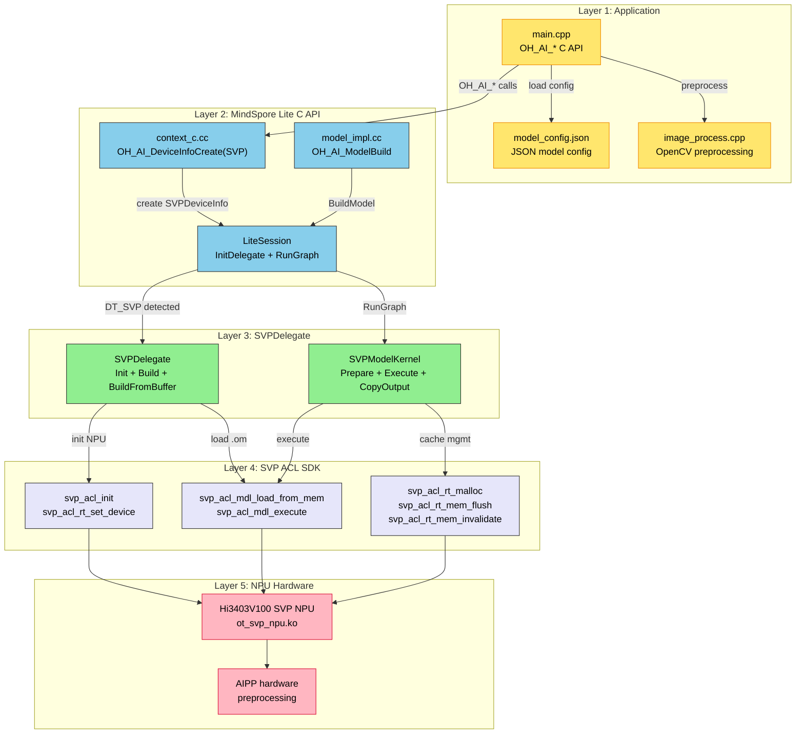
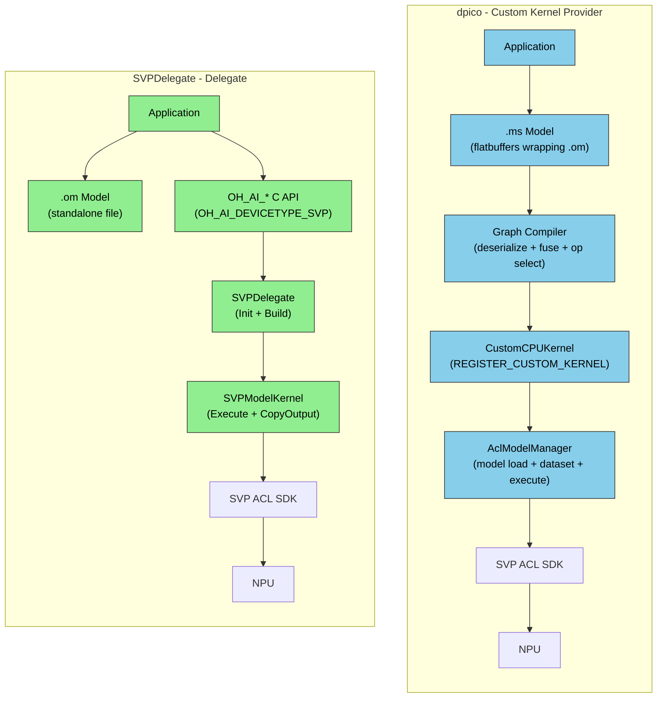
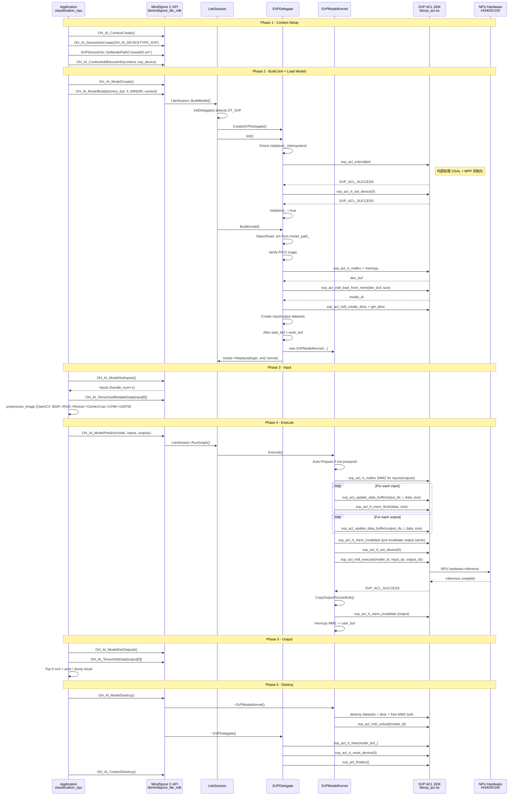

# MindSpore Lite SVPDelegate NPU 推理开发指导

本文档介绍如何在 Hi3403V100 芯片配套的 hispark_aifly 开发板的 OpenHarmony 小型系统上，
通过 MindSpore Lite SVPDelegate 实现 NPU 推理。以 ResNet50 图像分类模型为例，
说明从架构选型、代码实现、编译部署到性能精度验证的完整流程。

## 1. 需求背景

### 1.1 现状与痛点

Hi3403V100 搭载海思 SVP NPU，通过 SVP ACL SDK 可实现高效的神经网络推理。
但在 OpenHarmony 小型系统上，NPU 推理存在以下痛点：

| 痛点 | 影响 |
|------|------|
| **双 API 问题**：CPU 推理用 `OH_AI_*` C API，NPU 推理用 `svp_acl_*` 专用 API | 应用层需学习两套 API，代码不可复用 |
| **无统一设备选择**：MindSpore C API 不支持 `OH_AI_DEVICETYPE_SVP` 设备类型 | 应用层无法通过 `OH_AI_ContextCreate` 选择 NPU 后端 |
| **手动资源管理**：直接调用 SVP ACL 需手动管理 init/load/execute/unload | 开发者需深入了解 NPU 硬件初始化、MMZ 内存、缓存一致性等底层细节 |
| **SDK 初始化冲突**：`media_server` 等系统服务与 NPU 推理竞争 SVP 资源 | 板端运行推理时 crash（Signal 11） |

### 1.2 解决方案

实现 **SVPDelegate** —— 将 SVP ACL NPU 封装为 MindSpore Delegate 子类：

```
应用层 (OH_AI_* C API)
    → OH_AI_DeviceInfoCreate(OH_AI_DEVICETYPE_SVP)
    → OH_AI_ModelBuild(.om)
    → SVPDelegate::Init() → svp_acl_init + rt_set_device
    → SVPDelegate::Build() → svp_acl_mdl_load_from_mem
    → SVPModelKernel::Execute() → svp_acl_mdl_execute
    → NPU 硬件
```

**核心价值**：
- 应用层统一通过 `OH_AI_*` API 完成 CPU 和 NPU 推理，仅设备类型不同
- NPU 硬件初始化、MMZ 内存管理、缓存一致性对开发者透明
- 支持 `.om` 离线模型直接加载，无需运行时图转换

## 2. 软件架构

### 2.1 分层架构



### 2.2 竞分对比：dpico vs SVPDelegate

MindSpore Lite 提供了两种 NPU 集成方案：



| 维度 | dpico (Custom Kernel Provider) | SVPDelegate (Delegate) |
|------|-------------------------------|----------------------|
| **集成机制** | `REGISTER_CUSTOM_KERNEL` 逐算子注册 | `Delegate::Init/Build` 整图替换 |
| **模型格式** | .ms 包裹 .om（flatbuffers） | 独立 .om 文件 |
| **图支持** | 混合 CPU+NPU（部分委托） | 仅 NPU（全图替换） |
| **模型加载** | .om 从 .ms 最后一个 input tensor 提取 | .om 从文件路径或 buffer 直接读取 |
| **数据拷贝** | `CopyTensorDataToAclInputs`（逐 stride memcpy） | `svp_acl_update_data_buffer`（指针更新） |
| **模型类型** | CNN + ROI + RNN | 仅 CNN（分类） |
| **动态 batch** | 支持 `svp_acl_mdl_set_dynamic_batch_size` | 不支持（固定 batch=1） |
| **构建系统** | CMake → dpico_acl_adapter.so | GN/Ninja → 编入 mindspore_lite_ndk.so |
| **代码复杂度** | 26 文件，约 2000 行 | 4 文件，约 600 行 |
| **适用场景** | 标准系统，复杂模型 | 小系统，单模型推理 |

**选型结论**：small 系统选择 SVPDelegate，核心原因：

1. **小系统约束**：dpico 依赖完整图编译流程（flatbuffers 反序列化 + 算子融合），
   小系统开销过大。SVPDelegate 完全绕过图编译，直接加载 .om。
2. **简洁性**：4 文件 600 行 vs 26 文件 2000 行，维护成本显著降低。
3. **直接 .om 加载**：无需将 .om 包装为 .ms 格式，简化部署流程。
4. **性能优势**：指针更新比逐 stride memcpy 更轻量，Delegate 额外开销仅 0.55ms。
5. **统一 API**：`OH_AI_DEVICETYPE_SVP` 与 `OH_AI_DEVICETYPE_CPU` 并列，应用层代码可复用。

## 3. 实现方案

### 3.1 NPU 推理完整时序图



### 3.2 SVPDelegate 生命周期流程图

```mermaid
flowchart TD
    Start(["SVPDelegate created"]) --> InitCheck{"initialized_?"}
    InitCheck -->|"Yes"| InitSkip["Return kSuccess<br/>(idempotent)"]
    InitCheck -->|"No"| AclInit["svp_acl_init(nullptr)<br/>handles OSAL+MPP internally"]
    AclInit --> AclRet{"ret == SUCCESS<br/>or 100002?"}
    AclRet -->|"No"| InitFail["Return kLiteError"]
    AclRet -->|"Yes"| SetDevice["svp_acl_rt_set_device(device_id_)<br/>creates default context implicitly"]
    SetDevice --> InitDone["initialized_ = true"]

    InitDone --> BuildStart["Build(model) called"]
    BuildStart --> ReadOM["fopen/fread .om from model_path_"]
    ReadOM --> CheckMagic{"PICO magic?"}
    CheckMagic -->|"No"| BuildFail["Return kLiteError"]
    CheckMagic -->|"Yes"| RtMalloc["svp_acl_rt_malloc + memcpy<br/>(model to device memory)"]
    RtMalloc --> LoadMem["svp_acl_mdl_load_from_mem<br/>model_id assigned"]
    LoadMem --> CreateDesc["svp_acl_mdl_create_desc<br/>+ get_desc"]
    CreateDesc --> CreateDS["Create input dataset<br/>(user inputs + task_buf + work_buf)<br/>Create output dataset"]
    CreateDS --> CreateKernel["new SVPModelKernel(...)"]
    CreateKernel --> Replace["model->Replace(begin, end, kernel)"]
    Replace --> BuildDone["Build complete"]

    BuildDone --> ExecStart["Execute() called"]
    ExecStart --> PrepCheck{"prepared_?"}
    PrepCheck -->|"No"| AutoPrep["Auto-Prepare:<br/>svp_acl_rt_malloc for inputs/outputs<br/>populate raw metadata"]
    PrepCheck -->|"Yes"| UpdateIn
    AutoPrep --> UpdateIn["For each input:<br/>svp_acl_update_data_buffer<br/>svp_acl_rt_mem_flush"]
    UpdateIn --> UpdateOut["For each output:<br/>svp_acl_update_data_buffer"]
    UpdateOut --> PreInvalidate["Pre-invalidate output cache<br/>svp_acl_rt_mem_invalidate"]
    PreInvalidate --> SetDevExec["svp_acl_rt_set_device(0)"]
    SetDevExec --> MdlExec["svp_acl_mdl_execute<br/>(NPU hardware inference)"]
    MdlExec --> CopyOut["CopyOutputToUserBufs:<br/>invalidate + memcpy MMZ to user"]
    CopyOut --> ExecDone["Execute complete"]

    ExecDone --> Destroy["~SVPDelegate()"]
    Destroy --> DelKernel["delete SVPModelKernel<br/>(datasets/desc/task_buf/work_buf/unload)"]
    DelKernel --> FreeModelBuf["svp_acl_rt_free(model_buf_)"]
    FreeModelBuf --> ResetDev["svp_acl_rt_reset_device(0)"]
    ResetDev --> Finalize["svp_acl_finalize()"]
    Finalize --> End(["Resources released"])

    classDef decision fill:#FFD700,stroke:#333,color:#000
    classDef action fill:#87CEEB,stroke:#333,color:#000
    classDef success fill:#90EE90,stroke:#333,color:#000
    classDef error fill:#FFB6C1,stroke:#DC143C,color:#000
    classDef terminal fill:#E6E6FA,stroke:#333,color:#000

    class InitCheck,AclRet,CheckMagic,PrepCheck decision
    class AclInit,SetDevice,ReadOM,RtMalloc,LoadMem,CreateDesc,CreateDS,CreateKernel,Replace,UpdateIn,UpdateOut,PreInvalidate,SetDevExec,MdlExec,CopyOut,DelKernel,FreeModelBuf,ResetDev,Finalize action
    class InitDone,BuildDone,ExecDone,InitSkip success
    class InitFail,BuildFail error
    class Start,End terminal
```



### 3.3 预处理流程

板端使用 OpenCV 完成图像预处理，AIPP 硬件完成归一化：

```
CPU 侧 (OpenCV)                    NPU 硬件 (AIPP, 烘焙在 .om 中)
─────────────────                   ────────────────────────────────
JPEG decode (cv::imread)
BGR → RGB (cv::cvtColor)
Resize(256, keep ratio, cv::resize)
CenterCrop(224)
HWC → CHW (cv::split)
UINT8 CHW planar ──────→ AIPP ──→ (pixel - mean) × var_reci ──→ float32 ──→ 推理
```

与 ModelZoo `ImageprocessOptions(256, 224, true)` + `insert_op.cfg` 流程一致。

### 3.4 关键实现文件

| 文件 | 路径 | 说明 |
|------|------|------|
| `svp_delegate.h` | `third_party/mindspore/.../delegate/svp/` | SVPDelegate 头文件 |
| `svp_delegate.cc` | 同上 | Init + Build + BuildFromBuffer 实现 |
| `svp_model_kernel.h` | 同上 | SVPModelKernel 头文件 |
| `svp_model_kernel.cc` | 同上 | Prepare + Execute + CopyOutput 实现 |
| `main.cpp` | `applications/sample/camera/classification/npu/` | 通用推理入口（模型无关） |
| `image_process.cpp` | `npu/common/preprocess/` | OpenCV 预处理实现 |
| `model_config.h` | `common/` | 模型配置结构体 + JSON 加载 |
| `BUILD.gn` | `applications/sample/camera/classification/` | 编译配置 |

## 4. 编译预置条件

在编译 OpenHarmony 系统镜像前，需确认以下配置正确。

### 4.1 vendor config.json 组件配置

文件路径：`vendor/hisilicon/hispark_aifly_linux/config.json`

NPU 推理依赖以下两个组件，确认已启用：

```json
{
  "subsystem": "thirdparty",
  "components": [
    { "component": "mindspore", "features":["mindspore_feature_svp = true"] }
  ]
},
{
  "subsystem": "applications",
  "components": [
    { "component": "camera_sample_app", "features":[] }
  ]
}
```

| 组件 | 作用 | 关键特性 |
|------|------|---------|
| `mindspore` | MindSpore Lite 推理框架 + SVPDelegate | `mindspore_feature_svp = true` 启用 SVP NPU 编译开关 |
| `camera_sample_app` | 分类推理应用（含 CPU + NPU 目标） | 通过 bundle.json 引入 `classification` lite_component |

> `mindspore_feature_svp = true` 是 NPU 推理的**必要开关**。未启用时，SVPDelegate 代码不参与编译，
> `classification_npu` 可执行文件仍可链接成功但运行时 `Init()` 会返回 `kLiteError`。

**必须排除的子系统**：

config.json 中 **MUST NOT** 包含以下子系统，否则会引入与 NPU 资源冲突的系统服务：

| 排除的子系统 | 引入的冲突服务 | 冲突原因 |
|-------------|--------------|---------|
| `graphic` | `wms_server` | 启动时初始化 SVP 子系统，与 `svp_acl_init` 冲突 |
| `window` | `wms_server` | 同上 |
| `multimedia` | `media_server` | 启动时调用 `ss_mpi_sys_init`，导致 NPU "repeated initialization" crash |

> 默认 hispark_aifly_linux 的 config.json 面向图形/媒体产品形态，`subsystems` 数组中**已包含**上述三个子系统。
> 编译 NPU 推理镜像前，需手动从 `subsystems` 数组中删除这三项后重新编译。

### 4.2 bundle.json 构建配置

文件路径：`applications/sample/camera/bundle.json`

确认 `build.sub_component` 仅包含分类推理组件：

```json
"build": {
    "sub_component": [
        "//applications/sample/camera/classification:classification"
    ],
    "inner_kits": [],
    "test": []
}
```

> `classification` lite_component 包含 `classification_cpu` 和 `classification_npu` 两个可执行文件。
> 其他配置（`deps`、`features` 等）保持原有默认值即可。

### 4.3 init_linux_openharmony.cfg 服务配置

文件路径：`vendor/hisilicon/hispark_aifly_linux/init_configs/init_linux_openharmony.cfg`

NPU 推理需要独占 SVP 硬件资源，需确保 `media_server` 和 `wms_server` **未被启动**：

```
# 从 services 列表中删除（或注释）以下服务：
# "name" : "media_server"    ← 必须不存在
# "name" : "wms_server"      ← 必须不存在
```

> **原因**：`media_server` 和 `wms_server` 启动时会初始化 SVP 子系统（`ss_mpi_sys_init`），
> 与 SVPDelegate 的 `svp_acl_init` 产生"repeated initialization"冲突，导致 NPU 硬件状态不一致，
> `svp_acl_mdl_execute` 时 crash（Signal 11）。默认 hispark_aifly_linux 的 init 配置**已启动**这两个服务，
> 编译 NPU 推理镜像前需注释或删除 `media_server`、`wms_server` 的服务定义及相应启动项后重新编译。

### 4.4 编译依赖链

```
config.json
  ├── mindspore (mindspore_feature_svp = true)
  └── camera_sample_app
        └── bundle.json → classification (lite_component)
              ├── classification_cpu   (CPU 推理)
              └── classification_npu   (NPU 推理，依赖 mindspore_feature_svp = true)
                    ├── mindspore_lib    (OH_AI_* C API 实现)
                    ├── mindspore_ndk    (MindSpore Lite 核心)
                    └── opencv_world     (预处理，third_party/opencv/lib/)
```

### 4.5 板端运行时依赖

以下库需要在板端 `/usr/lib/` 中可用：

| 库文件 | 来源 | 部署方式 |
|--------|------|---------|
| `libmindspore-lite.so` | mindspore 组件编译产出 | 跟随 rootfs |
| `libmindspore_lite_ndk.so` | mindspore 组件编译产出 | 跟随 rootfs |
| `libopencv_world.so.412` | `third_party/opencv/lib/` | 需手动 hdc 推送到 `/storage/etc/` |
| `libprotobuf-c.so` | SVP ACL SDK 依赖 | 需创建软链接（见 5.2 节） |

## 5. 板端部署

### 5.1 推送模型和配置

```bash
# 通过 hdc 推送
hdc file send resnet50.om /storage/etc/resnet50.om
hdc file send model_config.json /storage/etc/model_config.json
hdc file send classification_npu /usr/bin/classification_npu
```

> OpenCV 库 (`libopencv_world.so.412`) 需通过 hdc 推送到 `/storage/etc/` 并创建软链接。

### 5.2 创建符号链接

```bash
# protobuf-c (SDK SONAME 修复)
ln -sf libprotobuf-c.so /usr/lib/libprotobuf-c.so.1

# OpenCV (板端预处理依赖)
ln -sf /storage/etc/libopencv_world.so.412 /usr/lib/libopencv_world.so.412
ln -sf libopencv_world.so.412 /usr/lib/libopencv_world.so
```

## 6. 验证

### 6.1 功能验证

```bash
classification_npu /storage/etc/resnet50.om \
    --config /storage/etc/model_config.json \
    /share/datasets/ImageNet/val/ILSVRC2012_val_00000001.JPEG
```

验证要点：
- `backend=SVP NPU`：确认路由到 NPU
- `AIPP: enabled`：确认 AIPP 配置已加载
- Top-5 结果非全零

### 6.2 性能验证

```bash
classification_npu /storage/etc/resnet50.om \
    --config /storage/etc/model_config.json \
    --stress 100
```

实测数据（ResNet50, Hi3403V100）：

| 指标 | 实测值 | ModelZoo 参考值 |
|------|:---:|:---:|
| 平均推理延迟 | **3.64 ms** | 2.99 ms |
| 吞吐量 | **274.7 fps** | 334.22 fps |
| 纯 NPU 执行 | ~3.09 ms (~324 fps) | 2.99 ms (334 fps) |
| Delegate 额外开销 | ~0.55 ms | - |
| NPU vs CPU 加速比 | **27.8x** | - |
| Stress test 成功率 | 100/100 | - |

> 性能差异分析：实测计时范围包含 cache flush/invalidate + MMZ 拷贝 + 输出 Tensor 堆分配，
> ModelZoo 仅计纯 `svp_acl_mdl_execute`。扣除额外开销后，纯 NPU 执行一致（~3.0ms）。

### 6.3 精度验证

```bash
classification_npu /storage/etc/resnet50.om \
    --config /storage/etc/model_config.json \
    --batch /share/datasets/ImageNet/file_list.json \
    --result_dir /share/result \
    --label /share/datasets/ImageNet/val_label.txt
```

实测精度（500 张 ImageNet 验证集子集）：

| 指标 | 实测值 | ModelZoo 参考 (50000 张) | 偏差 |
|------|:---:|:---:|:---:|
| Top-1 | **75.00%** | 76.05% | -1.05% |
| Top-5 | **93.20%** | 92.85% | +0.35% |

偏差在 ±2.5% 以内，属于 500 样本统计波动范围内。

## 7. 关键问题与解决

实现过程中发现并修复的关键问题：

| # | 问题 | 根因 | 解决方案 |
|---|------|------|---------|
| 1 | 推理输出全零（精度 0%） | MMZ 设备内存与 CPU 缓存不共享一致性协议 | Execute 前 `svp_acl_rt_mem_flush`，Execute 后 `svp_acl_rt_mem_invalidate` |
| 2 | shared_ptr SIGBUS | MMZ 内存上构造 shared_ptr 控制块触发对齐异常 | MMZ 内存改用 raw pointer 管理 |
| 3 | Build 成功但 Execute crash | `svp_acl_mdl_load_from_mem` 不深拷贝，ACL 内部仍引用 model buffer | `model_buf_` 保留到析构函数释放 |
| 4 | 重复初始化 crash | `svp_acl_init` 内部已封装 OSAL+MPP 初始化，单独调用导致重复 | Init() 简化为 `svp_acl_init` + `svp_acl_rt_set_device` |
| 5 | Context/Stream 不必要 | ModelZoo 模式仅需 `set_device` 即可执行推理 | Init() 中不创建 context/stream |

## 8. 其他模型集成

`classification_npu` 是模型无关的通用推理框架，通过 `model_config.json` 驱动。
集成新模型只需准备 `.om` 文件和对应的配置文件，无需修改 C++ 代码。

### 8.1 集成步骤

1. 从 [ModelZoo](https://modelzoo.hispark.hisilicon.com/#/ModelZoo) 下载对应 SVP_NNN 平台的 `.om` 模型
2. 编写 `model_config.json`（匹配模型的预处理参数和 AIPP 配置）
3. 推送到板端，通过 `--config` 参数指定配置文件运行

### 8.2 model_config.json 格式

```json
{
    "name": "resnet50",
    "type": "classification",
    "input_shape": [1, 3, 224, 224],
    "layout": "chw",
    "dtype": "uint8",
    "resize_shorter": 256,
    "crop_size": 224,
    "interpolation": 1,
    "num_classes": 1000,
    "top_k": 5,
    "aipp": {
        "enabled": true,
        "input_format": "RGB_PLANAR",
        "mean_chn": [123.675, 116.28, 103.53],
        "var_reci_chn": [0.0171247538316637, 0.0175070028011204, 0.0174291938997821]
    }
}
```

## 9. 参考资料

| 资料 | 路径/链接 |
|------|---------|
| NPU 推理验证指导 | `applications/sample/camera/classification/npu/README.md` |
| SVP ACL 开发指南 | https://gitcode.com/HiSpark/Hi3403V100/tree/master/docs/zh-CN/tools/SVP_NNN/应用开发指南 |
| ModelZoo NPU 推理案例 | `device/soc/hisilicon/hi3403v100/docs/zh-CN/porting-smallchip-ai-NPU-ModelZoo.md` |
| CPU MindSpore Lite 指导 | `device/soc/hisilicon/hi3403v100/docs/zh-CN/porting-smallchip-ai-CPU-MindSporeLite.md` |
| ModelZoo 模型下载 | https://modelzoo.hispark.hisilicon.com/#/ModelZoo |
