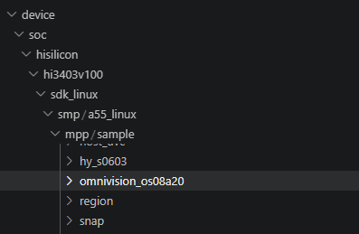
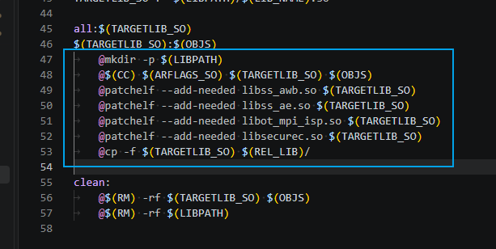
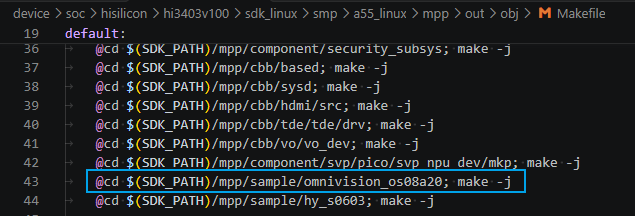
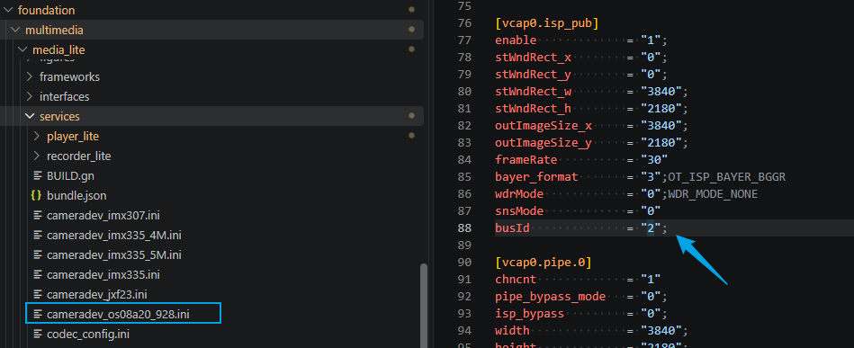
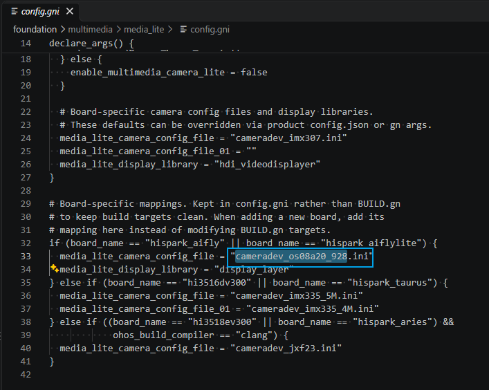
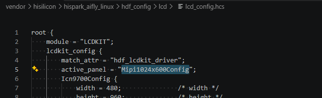
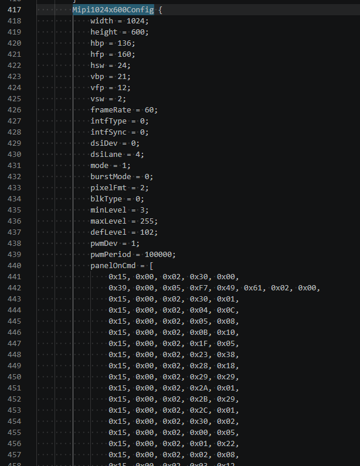
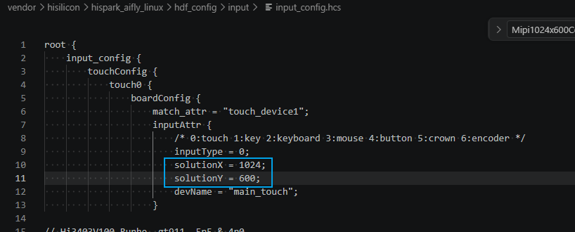
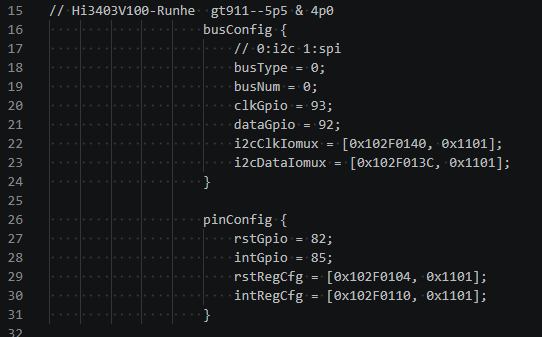
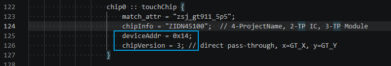

# 外设适配实操指南

本文基于 HiSpark_AiFly 开发板（Hi3403V100）的 OpenHarmony 小型系统源码，介绍相机 Sensor、MIPI 显示屏、GT911 触摸屏三类外设的适配步骤。

**前提条件**：外设硬件连接（线序、电平、供电）与 HiSpark_AiFly 开发板参考设计一致；所有修改需重新编译并烧录后生效。

## 1 相机 Sensor 适配（以 OS08A20 为例）

新增 Sensor 适配分为四步。

### 1.1 放置 Sensor 驱动源码

源码放置在 `device/soc/hisilicon/hi3403v100/sdk_linux/smp/a55_linux/mpp/sample/<sensor_dir>` 下，可参考同目录已有的 `omnivision_os08a20`、`hy_s0603` 工程。



### 1.2 Sensor 工程 Makefile 增加 ISP 依赖库链接

在动态库生成规则中加入 `patchelf` 依赖声明，并将产物拷贝到发布 lib 目录：

```makefile
$(TARGETLIB_SO):$(OBJS)
	@$(CC) $(ARFLAGS_SO) $(TARGETLIB_SO) $(OBJS)
	@patchelf --add-needed libss_awb.so $(TARGETLIB_SO)
	@patchelf --add-needed libss_ae.so $(TARGETLIB_SO)
	@patchelf --add-needed libot_mpi_isp.so $(TARGETLIB_SO)
	@patchelf --add-needed libsecurec.so $(TARGETLIB_SO)
	@cp -f $(TARGETLIB_SO) $(REL_LIB)/
```



### 1.3 增加 Sensor 编译入口

在 `device/soc/hisilicon/hi3403v100/sdk_linux/smp/a55_linux/mpp/out/obj/Makefile` 中，仿照现有 Sensor 工程的编译条目，增加新 Sensor 工程的编译步骤：

```makefile
@cd $(SDK_PATH)/mpp/sample/<sensor_dir>; make -j
```

> `<sensor_dir>`：Sensor 源码目录名（对应源码目录为 `sdk_linux/smp/a55_linux/mpp/sample/<sensor_dir>`）；clean 段中还需同步增加 `@cd $(SDK_PATH)/mpp/sample/<sensor_dir>; make clean` 清理条目。



### 1.4 新增 Sensor 配置文件并启用

- 在 `foundation/multimedia/media_lite/services/` 下新增 `cameradev_<sensor>.ini` 配置文件，内容参考 `cameradev_os08a20_928.ini`，其中 `busId` 对应 MIPI RX 通道号，AiFly 默认 Sensor 接 CSI 通道 2，故配置为 2，更换接口时需同步调整；

  

- 修改 `foundation/multimedia/media_lite/config.gni`，在 `hispark_aifly / hispark_aiflylite` 分支中将 `media_lite_camera_config_file` 指向新增的 ini 文件：

  

## 2 MIPI 显示屏适配

面板参数、上电初始化序列与面板选择均配置在 `vendor/hisilicon/hispark_aifly_linux/hdf_config/lcd/lcd_config.hcs`：

1. 新增（或复用）面板配置块，包含屏参时序与 DCS 初始化序列，可参考文件内已有的 `Mipi1024x600Config`、`Mipi800x1280Config`；
2. 将 lcdConfig 节点的 `active_panel` 设置为新面板配置块名。





若 `vendor/hisilicon/hispark_aifly_linux/hdf_config/` 目录下存在上次编译生成的 `hdf_hcs.hcb`，请先删除再编译（使 hcs 配置重新生成）。

## 3 触摸屏适配（GT911）

触摸配置在 `vendor/hisilicon/hispark_aifly_linux/hdf_config/input/input_config.hcs` 的 `touch0` 节点，按模组实际参数修改：

| 配置项 | 字段 | 说明 |
|---|---|---|
| 分辨率 | `boardConfig.inputAttr` 的 `solutionX / solutionY` | 与屏幕分辨率一致 |
| I2C 总线 | `busConfig` 的 `busNum / clkGpio / dataGpio` 及 `i2cClkIomux / i2cDataIomux` | 总线号与引脚复用寄存器 |
| 复位/中断引脚 | `pinConfig` 的 `rstGpio / intGpio` 及 `rstRegCfg / intRegCfg` | 引脚号与复用寄存器 |
| 供电 | `powerConfig` 的 `vcc* / vci*` | 供电类型、引脚与电压 |
| 从机地址 | `chipConfig` 对应 chip 节点的 `deviceAddr` | 按模组实际地址（如 0x14） |
| 坐标解析方式 | 对应 chip 节点的 `chipVersion` | 不同版本报点格式不同，按所用模组选择 |







与第 2 节相同：删除已生成的 `hdf_hcs.hcb`（若存在）后再重新编译烧录。
