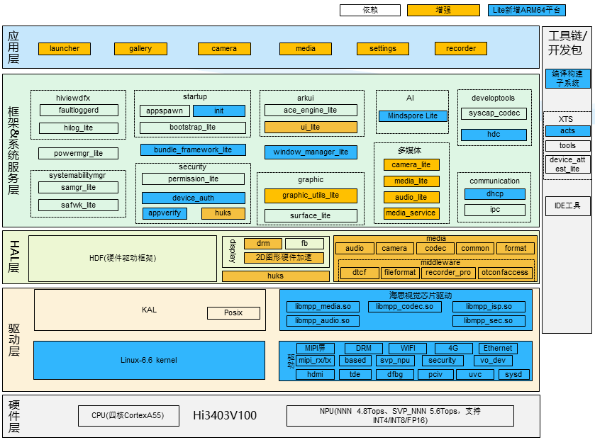

# 软件架构

本文说明 HiSpark AiFly（Hi3403V100）小型系统的软件分层。系统自下而上分为驱动层、HAL 层、框架&系统服务层、应用层；图中黄色模块为基于海思芯片硬件特性增强的组件，其余为 OpenHarmony 小型系统基础组件及芯片平台适配，各模块说明见下文分层介绍。

**图 1** HiSpark_AiFly Small 系统软件架构图

## 应用层

基于框架层提供的能力，适配典型应用场景：

- **launcher**：桌面应用，提供应用图标展示与点击启动能力。新增支持自适应分辨率，通过 OHOS::Screen::GetInstance() 接口获取系统分辨率并进行界面缩放，适配大屏显示
- **gallery**：图库应用，提供图片列表浏览、大图查看与视频播放能力。新增支持自适应分辨率（列表/大图/播放页自动适配系统分辨率）和后台异步解码大图（避免加载大图时阻塞界面），并补充示例媒体资源
- **camera**：相机应用，提供相机预览、拍照与录像能力。新增支持自适应分辨率；新增切入图库或退出应用时的相机停止与资源释放逻辑，避免相机占用；新增切换预览图时的图片缓存清理，降低内存占用
- **media**：音视频命令行样例集，覆盖音视频采集、播放等典型媒体场景。适配 AiFly，调整输出目录与采集/播放参数，对接新音频与播放接口
- **recorder**：录音机应用（HAP），提供录音主界面与录音列表。作为 AiFly 录音样例应用新增，仅在媒体接口升级产品中打入

## 框架&系统服务层

补齐 OpenHarmony 小型系统组件能力，适配图形、媒体与 AI 等子系统：

- **acts**：XTS 兼容性测试套件（测试子系统，用于产品兼容性验证，非运行时框架组件）适配：1）修复 testDisConnectAbility 社区用例缺陷，删除 g_errorCode==16 异常保护逻辑，使 DisconnectAbility 与 ConnectAbility 成对执行；2）修复 testIPCClient0130 在 arm64 架构下 svcIdentity.token 断言失败问题（uintptr_t 类型字长扩展导致与 0xffffffff 比较不相等）
- **appverify**：HAP 应用安装包签名与 Profile 验签组件。适配加密库接口：GetRsaPk/GetEcPk/GetPkBuf 等公钥获取接口的长度参数由 int32_t 调整为 size_t，并补充 malloc.h、stdlib.h 等头文件引用，保证 AiFly 上 HAP 验签可编译、可运行
- **build**：编译构建框架适配：1）lite 平台 BUILDCONFIG.gn 增加 target_cpu=arm64 分支，修复 Lite 设备平台不支持 arm64 CPU 架构的问题；2）language_cpp 标准由 C++11 升级至 C++17；3）ipcamera_hispark 类产品跳过 ohpm 初始化，并将芯片媒体 HAL 构建脚本加入 GN 执行白名单
- **bundle_framework_lite**：轻量包管理框架（BMS），提供 HAP 安装、卸载与信息查询能力。修复 small 系统上安装第 7 个 HAP 应用（含系统应用）后应用列表获取失败的问题：多应用 BundleInfo 序列化数据超出 Lite IPC 缓冲区上限导致溢出，Linux 内核下改用“按长度+索引”分批获取链路（HandleGetBundleInfosByIndex），并增加索引越界保护与真实错误码回传
- **device_auth**：精简 Lite IPC 调试输出：删除 ShowIpcSvcInfo 调试函数及 ipc_adapt、回调代理、认证代理中的冗余日志，降低运行噪音
- **dhcp**：DHCP 组件，提供动态 IP 地址获取能力。新增 dhcp_client_sdk 共享库与 Lite C 客户端 API（RegisterDhcpClientCallBack 等），补齐 Lite 侧客户端 SDK 与服务构建，支撑设置页联网与 IP 获取；权限侧补充 dhcpclientlite IPC 鉴权策略
- **hdc**：OpenHarmony 设备连接器。hdcd 守护进程适配 lite/small 构建体系（新增 OHOS_LITE 宏、日志切换为 hilog_lite、关闭异常与 CFI 等标准系统专属特性），使 small 系统可通过 DevEco Studio 进行 ArkJS 应用开发，支持常用 hdc 命令
- **huks**：统一密钥管理组件，对接芯片硬件安全能力提供硬件密钥加解密。新增支持 Root Key 硬件保护、基于 OTP 对称根密钥的高强度密钥派生和 UDID 直接从 OTP 硬件读取；通过宏隔离（huks_enable_hisilicon_cipher_in_small）兼容社区版本，芯片侧实现由 hal_huks 南向接口承接
- **init**：Lite 启动组件。SIGTERM 信号处理在 StopAllServices 之后补充 RebootSystem 调用，完善关机重启流程；ueventd 配置新增 /dev/ot_tde、/dev/ot_proc 设备节点 0666 权限，保障显示加速用户态库正常访问
- **MindSpore Lite**：轻量级 AI 推理框架。适配 small 系统构建：adapted_system_type 增加 small、日志依赖切换为 hilog_lite、nnacl 补充 -fasm/-fPIC 编译选项、测试目标仅在标准系统构建；另新增 mindspore_feature_svp 特性与 C API 头文件，支撑 SVPDelegate NPU 推理扩展
- **ui_lite**：轻量级图形 UI 组件（ArkUI），提供控件、布局、动画与绘制等基础 UI 能力，为 launcher、gallery 等应用提供界面框架。开启图形字体配置特性（ui_lite_enable_graphic_font_config）适配多分辨率屏幕；新增支持 PNG/JPEG 图片解码、Gralloc 内存引擎接入（GraphicStartUp）和新版 GFX 绘制引擎（媒体接口升级产品）
- **graphic_utils_lite**：图形基础组件，提供像素格式、绘图引擎、图像缓存等图形底层能力。新增支持基于 TDE 2D 图形加速引擎的硬件 Blit（缩放/透明度混合）、gralloc_engines 图形内存分配引擎、IMG_CACHE_MEMORY_CUSTOM 自定义图像缓存内存（媒体接口升级产品）和 DRM 显示 HAL（graphic_utils_lite_enable_drm_display_hal）
- **surface_lite**：轻量级图形缓冲区管理组件，基于生产者/消费者模型提供缓冲队列（BufferQueue）管理，衔接应用绘制、窗口合成与显示输出之间的图形数据流转
- **window_manager_lite**：轻量级窗口管理服务（WMS），提供窗口创建、合成管理与输入事件分发能力。新增支持新显示链路与大分辨率屏幕适配，以及输入侧鼠标设备识别兼容与热插拔
- **camera_lite**：轻量级相机组件，提供相机创建、参数配置、帧采集回调等能力，适配新版相机 HDI 接口，对接海思相机适配层。新增支持本地相机与分布式虚拟相机接入、相机热插拔检测（在位状态变化时实时回调通知应用）；新增相机生命周期与资源管理，关闭相机或服务退出时自动停止采集并释放资源，避免相机占用与内存泄漏
- **media_lite**：轻量级媒体组件，提供播放器、录制器及编解码框架能力，播放/录制链路适配 AiFly。新增支持 Hi3403 默认 OS08A20（8MP）sensor 的媒体设备配置（cameradev_os08a20_928.ini）及编解码、媒体参数配置；HY_S0603（4K）等其它 Sensor 需按[外设适配实操指南](./porting-smallchip-peripheral.md)新增对应 cameradev ini 配置
- **audio_lite**：轻量级音频组件，提供音频采集、播放与音量管理等能力。新增支持音频设备管理与本地/虚拟音源，媒体接口升级时对接 ALSA 库与工具
- **media_service**：媒体服务，为播放、录制与音视频输出提供公共能力支撑。扩展媒体公共类型（音频设备信息、连接状态、图层优先级等）、错误码与日志能力，并新增音视频同步 DFX 统计

## HAL 层

采用海思芯片硬件特性增强 OpenHarmony 组件能力，提供平台级 HAL 接口（均为架构图黄色增强模块）：

- **hal_huks**：实现 HUKS 硬件密钥加解密南向接口（由 drivers/peripheral/huks 的 huks_hdi_cipher.h 定义），封装 SoC 安全模块（OTP、密码加速引擎）调用流程，为 huks 组件提供 Root Key 保护、密钥派生、UDID 读取与硬件真随机数等底层安全能力
- **hal_display**：显示 HDI 适配实现，提供 display_layer（图层管理）、display_gfx（2D 硬件加速）、display_gralloc（图形内存分配）三类 HDI 模块；支持 FrameBuffer 与 DRM 双显示框架，对接 VO/TDE/HDMI 等 SDK 能力，支持 HDMI 高清输出、视频/叠加图层管理与 VPSS 资源调度
- **hal_media**：媒体 HDI 适配实现（audio、camera、codec、format、videodisplay 等），封装 MPP SDK 用户态接口（VI/VPSS/VENC/VDEC/AIO 等）并负责 SDK 模块初始化/去初始化管理，为上层提供音视频采集、编解码、封装解封装与输出处理能力

## 驱动层

- **Kernel**：升级至 Linux-6.6 内核。新增 hispark_aifly 内核配置目录（arm64_defconfig 芯片单板配置 + support_defconfig OpenHarmony 编译及鼠标等外设配置），按 small_defconfig→arm64_defconfig→support_defconfig→base_defconfig 顺序合并生成最终配置；内核补丁含芯片特性补丁与 OpenHarmony 编译适配补丁；因开启 CONFIG_MODULE_SIG，编译后通过 batch_sign_ko.sh 调用 scripts/sign-file（sha256）对 drm_kms_helper、smart_drm 等显示相关 ko 模块批量签名
- **显示驱动**：DRM 显示框架（smart_drm）、TDE（2D图形加速）、MIPI TX（显示接口）、HDMI 高清输出、MIPI 触控屏
- **采集驱动**：MIPI RX（摄像头接口），集成 HY_S0603（4K分辨率）和 OS08A20（800万像素）Sensor 驱动
- **智能驱动**：SVP NPU（Smart Vision Processing NPU）
- **系统驱动**：OSAL 系统适配层、sysconfig、ot_irq、ot_proc 等

> **命名说明**：Hi3403V100 的芯片 chipid 为 **SS928V100**，配置宏（`CONFIG_SS928V100`、`CONFIG_ARCH_SS928V100`）及其他文档中仍会出现 SS928，两者是同一颗芯片。